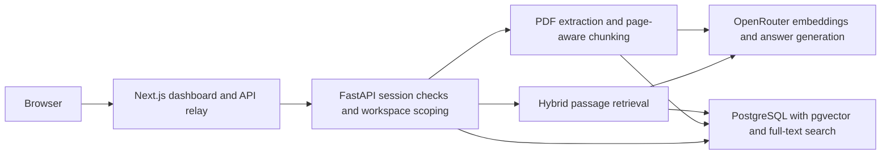
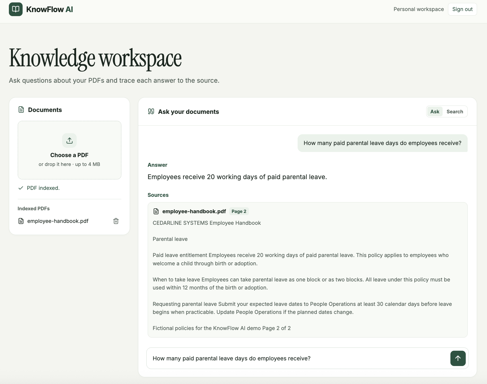

# KnowFlow AI

KnowFlow AI is a document search and question-answering app. Upload a PDF, search for a policy or reference ID, and ask questions in plain language. Answers cite the filename, page number, and supporting passage so you can check them against the source.

The project demonstrates a retrieval-augmented generation (RAG) pipeline, from PDF ingestion and hybrid search to cited answers and workspace isolation.

**[Try the live demo](https://knowflow-ai-web-preview.vercel.app/)** · **[Download the sample handbook](fixtures/employee-handbook.pdf)**

Create a KnowFlow account, upload the fictional handbook, and ask *How many paid parental leave days do employees receive?* The expected answer is **20 working days**, cited to **page 2**.

## Features

- **PDF ingestion** extracts text by page, splits it into passages, and indexes them for retrieval.
- **Hybrid search** combines PostgreSQL full-text search with pgvector similarity search. Source Search can fall back to keyword results when semantic search is unavailable.
- **Cited answers** use retrieved passages as evidence. The API validates citation IDs against those passages and can return an insufficient-evidence response.
- **Persistent document library** shows indexed PDFs after refresh or sign-in. Deleting a PDF removes its indexed passages.
- **Private workspaces** use sign-up, sign-in, and HTTP-only sessions. The API scopes document operations to the signed-in account’s workspace.
- **Evaluation suite** checks retrieval in the top five results, expected facts, citation evidence, and abstention across five handbook questions.

## Tech stack

| Layer | Technology |
| --- | --- |
| Frontend | Next.js, React, TypeScript |
| Backend | Python, FastAPI, Psycopg |
| PDF processing | PyMuPDF |
| Storage and retrieval | PostgreSQL, pgvector, PostgreSQL full-text search with a GIN index |
| Models | OpenRouter for embeddings and answer generation |
| Infrastructure | Docker Compose locally, Vercel and Neon in production |

## Architecture



1. **Indexing.** FastAPI extracts and chunks text page by page, embeds each passage, and stores the passages and vectors with their document and workspace IDs.
2. **Retrieval.** FastAPI searches within the signed-in workspace and combines vector and keyword ranks using reciprocal rank fusion. Both ranking paths use passages indexed for the active embedding model.
3. **Answering.** The model receives the question and retrieved passages. FastAPI resolves validated citation IDs to the original filename, page, and excerpt.

## Screenshot



## What the dashboard includes

| Area | What you can do |
| --- | --- |
| **Documents** | Upload a PDF, see which PDFs are indexed, and confirm deletion. PDFs indexed under an older model are marked for re-upload. |
| **Search** | Enter a topic, policy name, or reference ID and inspect matching excerpts with page numbers. |
| **Ask** | Ask a question and read the answer alongside its source passages. |
| **Account** | Create a private workspace, sign in, and sign out. |

## Start locally

Install **Python 3.11+**, **Node.js 20.9+**, and **Docker with Compose**. Use an OpenRouter API key for indexing and generated answers.

Clone the repository and start PostgreSQL:

```bash
git clone https://github.com/malihanawshin/KnowFlow-AI.git
cd KnowFlow-AI
docker compose up -d --wait db
```

Create an ignored file named `backend/.env` and set your key:

```dotenv
OPENROUTER_API_KEY=your_key_here
```

Start FastAPI from the repository root:

```bash
python3 -m venv .venv
source .venv/bin/activate
python -m pip install -r backend/requirements.txt
uvicorn backend.main:app --reload --env-file backend/.env
```

In a second terminal, start Next.js from the repository root:

```bash
npm ci --prefix frontend
npm run dev --prefix frontend
```

Open [localhost:3000](http://localhost:3000) and choose **Sign up**. The [FastAPI docs](http://localhost:8000/docs) are on port 8000, and Compose exposes PostgreSQL on port 5433. If FastAPI runs at a different URL, set `KNOWFLOW_API_URL` when starting Next.js.

<details>
<summary>Existing databases and evaluation</summary>

Fresh Compose volumes initialize both schemas automatically. For a database that still has the original fixed-dimension vector schema, run [the embedding migration](backend/migrate_embedding_models.sql) first. Reapply the current schemas to add missing tables and indexes to an existing volume:

```bash
docker compose exec -T db psql -v ON_ERROR_STOP=1 -U knowflow -d knowflow < backend/schema.sql
docker compose exec -T db psql -v ON_ERROR_STOP=1 -U knowflow -d knowflow < backend/schema_auth.sql
```

To run the [handbook evaluation](evaluation/handbook_cases.json), use a signed-in test account with a dedicated workspace:

```bash
.venv/bin/python evaluation/run.py --email reader@example.test
```

The runner prompts for the account password and uploads the handbook if needed. Add `--other-email reviewer@example.test` with an account in a separate, empty workspace to check isolation.

</details>

## Deployment

The public frontend runs on Vercel and uses a protected FastAPI deployment. The Next.js server relays requests to FastAPI using short-lived Vercel OIDC tokens. Visitors use KnowFlow sign-in on the public domain. Preview and production use separate Neon databases and separate Vercel Trusted Sources rules.

## Upcoming features

- **Multi-document research** to produce a cited brief across a workspace’s PDFs.
- **Team collaboration** with workspace invitations and roles.
- **Larger retrieval benchmark** with similar policies and exact reference IDs to compare hybrid search against vector-only search.

## Limitations

- Uploads are limited to **4 MB per PDF**. The app supports PDFs with extractable text. Scanned pages require OCR before upload.
- The app sends extracted text and questions to its configured model provider. Use fictional or non-sensitive documents when trying the demo.
- Accounts can reserve **15 model calls per UTC day**. OpenRouter’s shared free-model quota and model availability also affect indexing and generated answers.
- Changing embedding models requires re-uploading affected PDFs to make them searchable again. The existing evaluation covers a small fictional handbook, so citation quality can vary across other documents.
